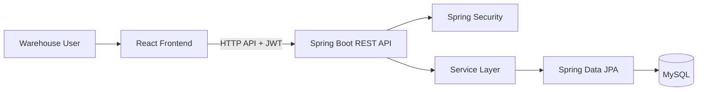

# ZiroLogistics — Warehouse Management System

ZiroLogistics is a warehouse management system (WMS) project built as a separate frontend and backend application.

The project focuses on warehouse and storage-location management, item catalog management, inventory movements, and inventory traceability.

## Repositories

| Component | Repository | Technology |
|---|---|---|
| Frontend | [ZiroLogistics-Frontend](https://github.com/Youuzzi/ZiroLogistics-Frontend) | React 19, Vite, Tailwind CSS 4 |
| Backend | [ZiroLogistics-Backend](https://github.com/Youuzzi/ZiroLogistics-Backend) | Java 21, Spring Boot 3.5, Spring Security, Spring Data JPA, MySQL |

## Current capabilities

- JWT-based sign-in and protected frontend routes.
- Warehouse and bin management.
- Item catalog management with SKU.
- Inbound and outbound inventory workflows.
- Stock transfer between storage bins.
- Inventory stock overview and paginated ledger history.
- Warehouse dashboard summary.
- Backend role-based authorization.

Refer to each repository for implementation details and setup instructions.

## Architecture at a glance



## Local development

### Backend

Requirements:
- Java 21
- MySQL 8.x
- Maven (or Maven Wrapper if available in the local checkout)

Create a database, configure the datasource credentials in the local application configuration, then run:

```bash
mvn spring-boot:run
```

The API is expected to be available at `http://localhost:8080` with the default local configuration.

### Frontend

Requirements:
- Node.js compatible with the installed Vite version
- npm

```bash
git clone https://github.com/Youuzzi/ZiroLogistics-Frontend.git
cd ZiroLogistics-Frontend
npm install
npm run dev
```

The Vite development server normally starts at `http://localhost:5173`.

The frontend API client is configured in the source code. Ensure its base URL points to the backend environment you are running.

## Technical areas

The backend source includes authentication and authorization, inventory services, persistence, and transaction-related logic. Specific guarantees such as concurrency safety and idempotent processing should be evaluated against their implementation and automated tests; this overview does not claim a particular test coverage level.

## Project status

This is an independent development project and remains subject to ongoing implementation, UI refinement, documentation, and testing.

## Developer

**Yozi Heru Maulana** — [GitHub](https://github.com/Youuzzi)

